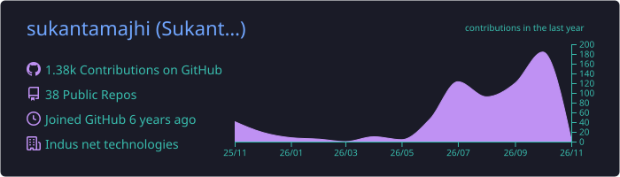
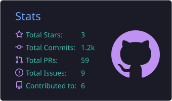
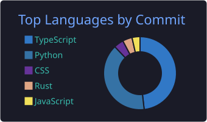
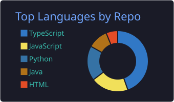
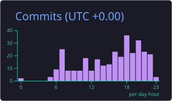

<h1 align="center">Hi 👋, I'm Sukanta Majhi</h1>
<h3 align="center">Full-stack developer from Kolkata, India 🇮🇳</h3>

  
  
  

---

## 🧑‍💻 About me

- 🏢 Software developer at **Indus Net Technologies**
- 🌍 Based in **Kolkata, India** (working from home 🏠)
- 🔭 Currently building **[Forge IDE](https://github.com/sukantamajhi/forge-ide)**, a GPU-rendered code editor written in Rust
- 🌱 Learning more **Rust**, **Go** and systems programming
- 📦 Published an npm package: **[api-config](https://github.com/sukantamajhi/api-config)**
- 🤖 Building **AI-powered products**: recruitment and interviews, pet commerce, and developer productivity tools
- 💬 Ask me about **JavaScript/TypeScript, Node.js, React/Next.js, NestJS and Spring Boot**
- 📫 Reach me on [LinkedIn](https://www.linkedin.com/in/sukanta-majhi/)

---

## 🛠️ Tech stack

**Languages**

**Frontend**

**Backend**

**Databases & tools**

---

## 🚀 Featured projects

> Projects marked 🔒 are private. Happy to walk through them on request.

### ⚡ [Forge IDE](https://github.com/sukantamajhi/forge-ide)
A fast, GPU-rendered code editor for Windows, built in Rust on GPUI. It offers VS Code-style editing, source control, previews and extensions, and is built to open instantly and stay smooth on large files.

**Tech focus:** Rust · GPUI · GPU rendering · editor performance

### 📦 [api-config](https://github.com/sukantamajhi/api-config)
An open-source npm package for API configuration, published for other developers to use.

**Tech focus:** TypeScript · npm package publishing

### 🐾 AI-Powered Pet Ecommerce Platform 🔒
An intelligent pet commerce application that combines a traditional ecommerce experience with personalized pet care assistance.

- Product discovery and ecommerce functionality
- Pet profiles with personalized recommendations
- AI-powered shopping assistant and semantic search
- Automated product reordering and subscriptions
- Pet care reminders and personalized experiences

**Tech focus:** Full-stack development · AI integration · ecommerce workflows · personalized recommendations

### 🤖 AI-Powered Hiring & Interview Platform 🔒
A recruitment platform that streamlines candidate screening while keeping recruiters in control of hiring decisions.

- Multi-company recruitment management
- Job creation and candidate applications
- Automated interview invitations
- AI-powered interviews based on resumes and job requirements
- Structured assessment reports covering technical and behavioral competencies
- Human-in-the-loop evaluation and recruiter decision-making

**Tech focus:** AI integration · asynchronous workflows · multi-tenant SaaS architecture · real-time interview experiences

### 📄 Document & Invoice Processing Automation 🔒
A business document processing solution that extracts structured information from invoices, purchase orders and other documents.

- Document parsing without relying on AI
- Structured data extraction and validation
- Excel and Word output generation
- Extensible processing for additional business document types

**Tech focus:** Document processing · data extraction · validation · business automation

### ⏱️ Commit-Based Timesheet Automation 🔒
An automation tool that turns Git commit activity into meaningful timesheet entries.

- Collects daily commit information
- Generates structured work summaries
- Organizes task titles, descriptions and acceptance criteria
- Reduces manual effort in timesheet preparation

**Tech focus:** Git automation · structured data processing · AI-assisted developer productivity

### 🏁 Race Mentor 🔒
A project exploring branding and product design. It reflects my interest in building practical applications with a clear identity and a strong user experience.

**Tech focus:** Branding · product design · user experience

---

## 📊 GitHub stats

  

  
  

  
  

  

---

⭐ Thanks for stopping by! Feel free to star any repo you find useful. ⭐

